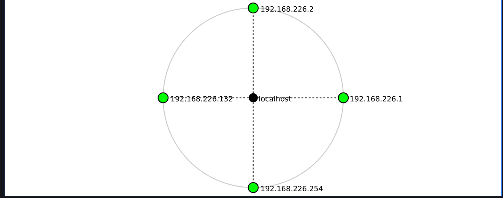

# Networkwalks-W2-B084--footprinting-scanning--

# PENETRATION TESTING REPORT: FOOTPRINTING AND NETWORK SCANNING
## W2-PM-FINAL | CYBERSECURITY | NETWORKWALKS

**Week 2 Pentest Report – Footprinting networkwalks.com and Network Scanning**

| Details | Information |
|---|---|
| **Pentester Name** | Krrish Pravin Mukamad |
| **Program / Batch** | B084 - Networkwalks |
| **Date** | 10 November 2026 |
| **Modules Completed** | W2-PM1 (Multiple Kali Tools), W2-PM5 (Network Scanning) |
| **Client / Target** | 1. Networkwalks (networkwalks.com)  2. My Own Local Network |
| **Testing Scope** | Public information gathering and own local virtual network |
| **Phases Covered** | Phase 1: Reconnaissance and Footprinting  Phase 2: Scanning and Network Discovery |

---

# 1. Liability Disclaimer

I have performed these activities for educational and research purposes within the scope of my cybersecurity training. Network scanning was performed on my own local virtual network, and domain reconnaissance was limited to publicly available information.

All activities should be conducted only on systems and devices for which appropriate permission has been obtained.

The instructor, authors and Networkwalks are not responsible for any misuse of the information presented in this report. Unauthorised access to computer systems and networks may result in legal consequences.

# 2. Introduction

This report covers footprinting the networkwalks.com domain using multiple Kali Linux tools (W2-PM1) and scanning my own local network using Nmap (W2-PM5).

The first module focuses on reconnaissance and footprinting, while the second module focuses on network scanning and host discovery.

These activities demonstrate how cybersecurity professionals collect publicly available information about a target and identify active devices within a network before conducting further security assessments.

The footprinting activities were performed using Kali Linux. Network configuration information was collected using Linux networking commands, and Nmap was used to perform host discovery on my local virtual network.

Every activity includes the command used, the information collected, its security significance and supporting screenshots where available.

# 3. Tools Used

The following tools were used during the practical activities.

| Tool | Purpose |
|---|---|
| Kali Linux | Operating system used for cybersecurity activities |
| WHOIS | Find domain registration details, registrar, dates and name servers |
| WhatWeb | Identify website technologies and frameworks |
| nslookup | Resolve domain names into IP addresses |
| curl -I | Inspect HTTP response headers |
| wafw00f | Detect Web Application Firewall technology |
| dnsrecon | Enumerate publicly available DNS records |
| Nmap | Discover active hosts on a network |
| Zenmap | Graphical interface for Nmap scanning |
| ip route | Identify local IP address, gateway and network routes |

# 4. Activities Performed

## 4.1 Footprinting and Reconnaissance (W2-PM1)

I performed reconnaissance against the networkwalks.com domain using six Kali Linux tools: WHOIS, WhatWeb, nslookup, curl, wafw00f and dnsrecon.

Each tool provides different information about the target's publicly accessible infrastructure.

### Task 1 – WHOIS Command

**Command:**

```bash
whois networkwalks.com
```

WHOIS was used to collect publicly available domain registration information.

The lookup returned the following details:

| Information | Result |
|---|---|
| Domain Name | NETWORKWALKS.COM |
| Registrar | GoDaddy.com, LLC |
| Registrar IANA ID | 146 |
| Registry Domain ID | 2452319255_DOMAIN_COM-VRSN |
| Creation Date | 06 November 2019 |
| Updated Date | 12 November 2025 |
| Expiry Date | 06 November 2027 |
| Name Server 1 | NS6135.HOSTGATOR.COM |
| Name Server 2 | NS6136.HOSTGATOR.COM |
| DNSSEC | Unsigned |
| Domain Status | ClientDeleteProhibited |
| Additional Status | ClientRenewProhibited |
| Additional Status | ClientTransferProhibited |
| Additional Status | ClientUpdateProhibited |

**Observation:**

The WHOIS lookup revealed that the domain is registered through GoDaddy.com, LLC and uses HostGator name servers.

It also provided domain creation and expiry dates, registration status codes and DNSSEC information.

**Security Significance:**

WHOIS information helps security professionals understand the public registration details and DNS infrastructure associated with a domain.

**Screenshot – WHOIS Lookup**


### Task 2 – WhatWeb Command

**Command:**

```bash
whatweb networkwalks.com
```

WhatWeb was used to fingerprint the technologies used by the target website.

The reference practical results reported the following technologies:

- Apache Web Server
- WordPress CMS
- WordPress Download Manager
- Bootstrap
- jQuery
- HTML5
- Google Tag Manager

The reported website title was Networkwalks Academy.

**Observation:**

WhatWeb helps identify technologies and software components that are publicly detectable on a website.

**Security Significance:**

Technology fingerprinting can help security professionals identify software versions that should be checked against security advisories.

**Screenshot – WhatWeb**


### Task 3 – nslookup Command

**Command:**

```bash
nslookup networkwalks.com
```

The nslookup command was used to resolve the domain name into its corresponding IP address.

**Observed IP Address:**

```text
192.232.216.135
```

**Observation:**

The domain resolved to the IPv4 address 192.232.216.135 in the supplied practical results.

**Security Significance:**

DNS lookup helps identify the public IP address associated with a domain and provides useful information about its network infrastructure.

**Screenshot – nslookup**


### Task 4 – curl HTTP Headers

**Command:**

```bash
curl -I https://networkwalks.com
```

The curl command was used to retrieve HTTP response headers from the website.

The supplied practical results reported:

- HTTP response status: 200
- Server: Apache
- x-nginx-cache: WordPress
- WordPress REST API endpoint: /wp-json/
- Secure and HttpOnly cookie attributes

**Observation:**

HTTP response headers can reveal information about the web server, application technology and website configuration.

**Security Significance:**

Analysing HTTP headers helps security professionals understand how a web application responds to requests and whether unnecessary technical information is exposed.

**Screenshot – curl**


### Task 5 – WAF Detection using wafw00f

**Command:**

```bash
wafw00f networkwalks.com
```

Wafw00f was used to identify whether a Web Application Firewall protects the website.

The supplied practical results identified:

**Detected WAF:** ModSecurity (SpiderLabs)

**Observation:**

A Web Application Firewall helps monitor and filter potentially malicious HTTP requests before they reach the web application.

**Security Significance:**

Identifying the presence of a WAF helps security professionals understand the defensive technologies protecting a web application.

**Screenshot – wafw00f**


### Task 6 – DNS Enumeration using dnsrecon

**Command:**

```bash
dnsrecon -d networkwalks.com
```

DNSRecon was used to enumerate publicly available DNS records.

The supplied practical results reported the following information:

| DNS Record | Observation |
|---|---|
| SOA | ns6135.hostgator.com |
| NS | ns6135.hostgator.com |
| NS | ns6136.hostgator.com |
| MX | mail.networkwalks.com |
| A | 192.232.216.135 |
| DNSSEC | Unsigned |
| BIND Version | 9.16.23-RH |

The reported DNS information also included SPF and Google site-verification TXT records.

**Observation:**

DNSRecon helps identify DNS records associated with a domain, including mail servers, name servers and other infrastructure details.

**Security Significance:**

DNS enumeration provides a better understanding of the target's public DNS infrastructure and helps identify information that should be reviewed from a security perspective.

**Screenshot – dnsrecon**


---

## 4.2 Network Scanning (W2-PM5)

For the second activity, I used Kali Linux to identify my local network configuration and perform network discovery.

The objective was to identify my IP address, default gateway, network subnet and active hosts.

### Step 1 – Identify Network Configuration

**Command:**

```bash
ip route
```

This command was used to identify the network interface, default gateway and available network routes.

**My Kali Linux Network Details:**

| Item | Result |
|---|---|
| Operating System | Kali Linux |
| Network Interface | eth1 |
| Kali Linux IP Address | 192.168.226.132 |
| Default Gateway | 192.168.226.2 |
| Network Subnet | 192.168.226.0/24 |
| Network Type | Virtual Network |

**Observation:**

The command helped me identify the active network interface and the subnet used by my Kali Linux virtual machine.

### Step 2 – Perform Network Scanning

After identifying the network subnet, I used Nmap to discover active hosts.

**Command:**

```bash
nmap -sn 192.168.226.0/24
```

The `-sn` option performs host discovery without performing a port scan.

**Scan Results:**

| Item | Result |
|---|---|
| Target Network | 192.168.226.0/24 |
| Scan Type | Ping Scan / Host Discovery |
| Total IP Addresses | 256 |
| Live Hosts Discovered | 4 |
| Nmap Command | nmap -sn 192.168.226.0/24 |

**Observation:**

The Nmap scan successfully discovered four live hosts on my local virtual network.

This practical helped me understand how Nmap identifies active devices within a network.

**Screenshot – Nmap Network Scan**


### Step 3 – Network Topology

Network topology provides a visual representation of connected devices and their network relationships.

The topology can be generated using Zenmap after performing an appropriate network scan.

**Purpose:**

- Visualise discovered network devices.
- Understand network connections.
- Identify active hosts.
- Maintain network documentation.

**Screenshot – Network Topology**



# 5. Risk Analysis / Impact

Based on the footprinting and network scanning activities, I identified the following potential security observations.

| No. | Risk / Finding | Evidence / Observation | Potential Impact | Level |
|---|---|---|---|---|
| 1 | Domain registration information exposed | WHOIS identified registrar, creation date and name servers | Helps map domain infrastructure | Low |
| 2 | Website IP address identifiable | DNS resolution returned 192.232.216.135 | Reveals the public hosting endpoint | Low |
| 3 | Website technology fingerprinting | WhatWeb results reported website technologies | Helps identify software that may require security updates | Medium |
| 4 | HTTP technical information exposed | curl response headers disclosed server information | Assists technology fingerprinting | Low |
| 5 | WAF technology identifiable | wafw00f reported ModSecurity | Reveals publicly detectable defensive technology | Low |
| 6 | DNS infrastructure information exposed | DNSRecon identified DNS records and name servers | Helps map public DNS infrastructure | Medium |
| 7 | DNSSEC unsigned | WHOIS reported DNSSEC as unsigned | DNS responses do not receive DNSSEC validation | Medium |
| 8 | Multiple live hosts discovered | Nmap identified four live hosts on my virtual network | Requires device identification and network inventory | Informational |

The above findings are preliminary observations from reconnaissance and network discovery.

No exploitation or vulnerability validation was performed. Therefore, the presence of publicly available information or a live network host does not automatically indicate a security vulnerability.

Further authorised testing would be required to confirm any actual security weakness.

# 6. Recommendations

Based on the observations from these activities, I recommend the following security improvements:

1. **Review publicly exposed technology information:** Organisations should regularly review information about their website technologies and server configuration.

2. **Keep software updated:** CMS platforms, plugins, libraries and web server components should be updated regularly.

3. **Review HTTP response headers:** Unnecessary technical information should be removed where practical, and appropriate security headers should be configured.

4. **Review DNS configuration:** DNS records should be checked periodically to ensure that only required information and services are exposed.

5. **Consider enabling DNSSEC:** Organisations should evaluate DNSSEC deployment to provide cryptographic validation of DNS responses.

6. **Monitor WAF configuration:** Web Application Firewall rules should be maintained and monitored to help protect web applications.

7. **Perform regular network discovery:** Organisations should periodically identify active devices connected to their networks.

8. **Maintain network documentation:** Network diagrams and device inventories should be maintained and updated.

9. **Investigate unknown devices:** Unexpected devices discovered during network scans should be identified and verified.

10. **Perform authorised security testing:** Reconnaissance and network scanning should always be conducted within an approved testing scope.

# 7. Conclusion

During Week 2 of my Cybersecurity & Ethical Hacking Internship at Networkwalks, I completed practical activities related to footprinting, reconnaissance and network scanning.

In the footprinting activity, I learned how to use six Kali Linux tools: WHOIS, WhatWeb, nslookup, curl, wafw00f and dnsrecon.

WHOIS helped me understand domain registration details, while WhatWeb helped identify website technologies. The nslookup command was used to resolve the domain name into an IP address. I also learned how curl can inspect HTTP response headers, wafw00f can identify a Web Application Firewall and dnsrecon can enumerate DNS records.

In the network scanning activity, I used the `ip route` command to identify my Kali Linux network configuration.

My Kali Linux virtual machine was using the IP address 192.168.226.132 with the default gateway 192.168.226.2 and network subnet 192.168.226.0/24.

I then performed network discovery using the Nmap command:

```bash
nmap -sn 192.168.226.0/24
```

The scan successfully discovered four live hosts on my local virtual network.

These activities helped me understand the importance of reconnaissance, DNS enumeration, website fingerprinting and network discovery in cybersecurity.

I also learned that proper documentation and authorised testing are important parts of a professional penetration-testing process.

Overall, Week 2 provided practical knowledge of the initial phases of penetration testing and improved my understanding of how cybersecurity professionals gather information about networks and web applications.

# 8. Evidence Collected

The following screenshots are included as evidence of the practical activities.

### Evidence 1 – WHOIS Lookup


### Evidence 2 – WhatWeb Technology Fingerprinting


### Evidence 3 – nslookup DNS Resolution


### Evidence 4 – curl HTTP Response Headers


### Evidence 5 – wafw00f WAF Detection


### Evidence 6 – dnsrecon DNS Enumeration


### Evidence 7 – Nmap Network Scan


### Evidence 8 – Network Topology


---

# 9. Project Information

| Details | Information |
|---|---|
| Program Name | Cybersecurity & Ethical Hacking Internship at Networkwalks |
| Week | 02 |
| Modules | W2-PM1, W2-PM5 |
| Batch | B084 |
| Author | Krrish Pravin Mukamad |
| GitHub | [KrrishMukadam](https://github.com/KrrishMukadam) |

**End of Report**

Author: Krrish Pravin Mukamad  
Batch: B084  
Organisation: Networkwalks  
Project: Week 2 – Footprinting and Network Scanning
