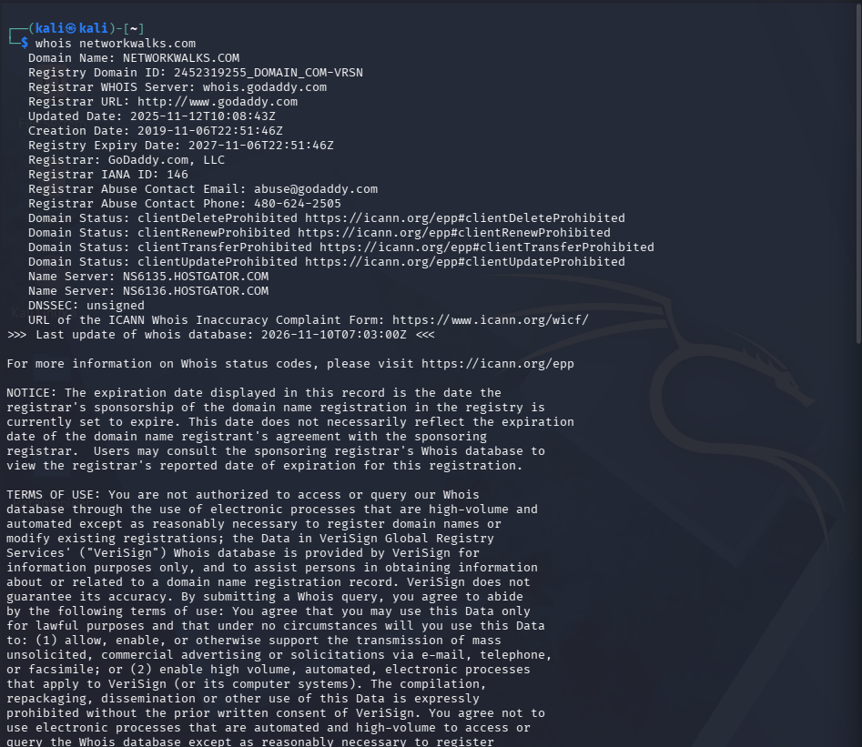
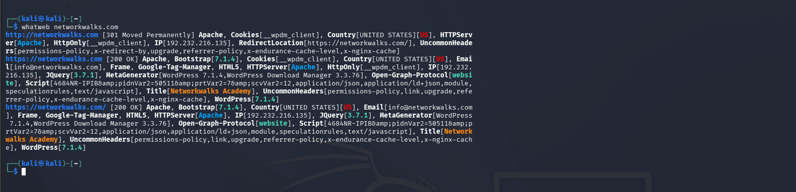
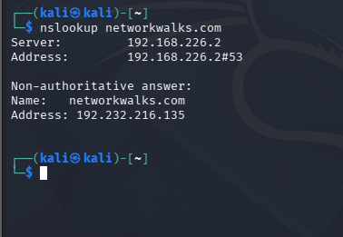
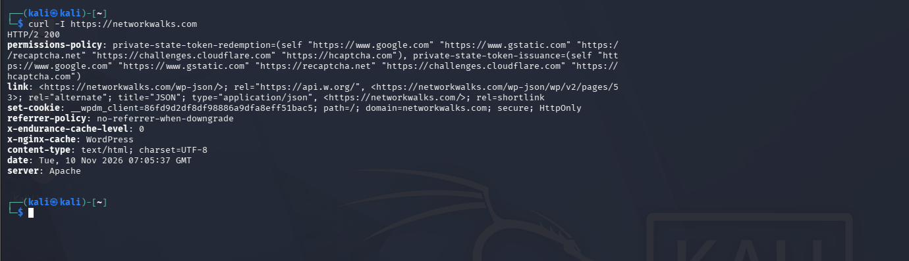
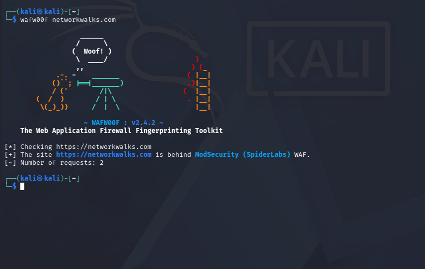
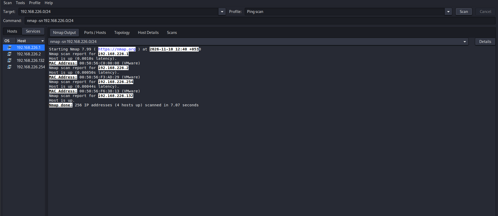

# Networkwalks-W2-B084--footprinting-scanning--

# PENETRATION TESTING REPORT
## FOOTPRINTING and NETWORK SCANNING PHASES
### W2-PM-FINAL | CYBERSECURITY | NETWORKWALKS

**Week 2 pentest report — footprinting networkwalks.com and network scanning**

| | |
|---|---|
| **Pentester Name** | Krrish Pravin Mukamad |
| **Program / Batch** | B084 - Networkwalks |
| **Date** | 10 November 2026 |
| **Modules completed** | W2-PM1 (Multiple Kali Tools) <br> W2-PM5 (Network Scanning) |
| **Client / Target** | 1. Networkwalks (public information reconnaissance) <br> 2. My own local virtual network |
| **Permission / Scope** | Public information gathering and scanning of my own virtual network |
| **Phases covered** | Phase 1: Reconnaissance and Footprinting <br> Phase 2: Scanning and Network Discovery |

---

# 1. Liability Disclaimer

I have performed these activities for educational and research purposes within the scope of my cybersecurity training. Network scanning was performed on my own local virtual network, and domain reconnaissance was limited to publicly available information.

All activities should be conducted only on systems and devices for which appropriate permission has been obtained. The instructor, authors and Networkwalks are not responsible for any misuse of the information presented in this report.

Unauthorised access or scanning of computer systems and networks may result in legal consequences. Every security assessment must be performed within an authorised scope.

# 2. Introduction

This report covers footprinting the networkwalks.com domain using multiple Kali Linux tools (W2-PM1) and scanning my own local network using Nmap (W2-PM5).

One module covers the footprinting phase and the other covers the network scanning phase. Together, they demonstrate how cybersecurity professionals gather publicly available information about a target and identify active devices within a network.

The footprinting activities were performed using Kali Linux. Network configuration information was collected using Linux networking commands, and Nmap was used to perform host discovery on my local virtual network.

Every step below includes the command used, the result observed, a screenshot as evidence where available, and a short explanation of why the finding matters from a security perspective.

# 3. Tools Used

The following table lists the tools used in this report and their purposes.

| Tool | Purpose |
|---|---|
| Kali Linux | Operating system used for reconnaissance and network scanning activities |
| WHOIS | Find domain registration details, registrar, dates and name servers |
| WhatWeb | Fingerprint web technologies, CMS and server information |
| nslookup | Resolve domain names into IP addresses using DNS |
| curl -I | Read HTTP response headers of a website |
| wafw00f | Detect whether a Web Application Firewall protects a website |
| Nmap | Discover active hosts on a network |
| Zenmap | Graphical interface for Nmap scanning |
| Linux Terminal | Execute reconnaissance and network commands |
| ip route | Identify local IP address, gateway and network routes |

# 4. Activities Performed

## 4.1 Footprinting & Reconnaissance (W2-PM1)

I performed reconnaissance against the networkwalks.com domain using five Kali Linux tools: WHOIS, WhatWeb, nslookup, curl and wafw00f. Each tool was used to collect a different type of publicly available information about the target.

### Task 1 – WHOIS

**Command:**
```bash
whois networkwalks.com
```

WHOIS returned publicly available registration information for the domain.

The supplied practical results reported that the domain is registered through GoDaddy.com, LLC (IANA ID 146), was created on 6 November 2019, was last updated on 12 November 2025, and is set to expire on 6 November 2027.

The registry domain ID is 2452319255_DOMAIN_COM-VRSN.

The domain uses two HostGator name servers:

- NS6135.HOSTGATOR.COM
- NS6136.HOSTGATOR.COM

The domain also carries four client-side protection status codes:

- clientDeleteProhibited
- clientRenewProhibited
- clientTransferProhibited
- clientUpdateProhibited

DNSSEC is listed as unsigned.

**Observation:**

WHOIS provides publicly available information about domain registration, registrar details, name servers and domain status.

**Security Significance:**

This information helps security professionals understand the public registration details and infrastructure associated with a domain.

### Task 2 – WhatWeb

**Command:**
```bash
whatweb networkwalks.com
```

WhatWeb fingerprinted the technologies behind the website.

The supplied practical results reported that http://networkwalks.com redirects to the HTTPS version and identified the following technologies:

- Apache Web Server
- WordPress 7.1
- WordPress Download Manager 3.3.58
- Bootstrap 7.1
- jQuery 3.7.1
- HTML5
- Google Tag Manager

It also returned the website title "Networkwalks Academy", the contact address info@networkwalks.com and the server IP address 192.232.216.135.

**Observation:**

WhatWeb helps identify publicly detectable website technologies, CMS platforms, frameworks and plugins.

**Security Significance:**

Technology fingerprinting helps security professionals identify software components that should be checked against current security advisories.

### Task 3 – nslookup

**Command:**
```bash
nslookup networkwalks.com
```

Using the public DNS resolver at 8.8.8.8, nslookup returned a non-authoritative answer resolving networkwalks.com to the IPv4 address:

```text
192.232.216.135
```

This matched the IP address reported by WhatWeb in the supplied practical results.

**Observation:**

The nslookup command successfully resolved the domain name into its corresponding IPv4 address.

**Security Significance:**

DNS resolution helps identify the public IP address associated with a domain and provides useful information about its network infrastructure.

### Task 4 – curl -I

**Command:**
```bash
curl -I https://networkwalks.com
```

The supplied practical results reported an HTTP/2 200 response.

The response headers disclosed:

- server: Apache
- x-nginx-cache: WordPress
- WordPress REST API endpoint: /wp-json/
- __wpdm_client cookie with HttpOnly and Secure attributes

A permissions-policy header and a referrer-policy of no-referrer-when-downgrade were also present.

**Observation:**

The curl command helps inspect HTTP response headers and understand how a web server responds to requests.

**Security Significance:**

HTTP headers may disclose technical information about the web server and application. Reviewing these headers helps organisations understand and improve their security configuration.

### Task 5 – wafw00f

**Command:**
```bash
wafw00f networkwalks.com
```

Wafw00f v2.4.2 was used to identify whether the target website is protected by a Web Application Firewall.

The supplied practical results identified:

**Detected WAF:** ModSecurity (SpiderLabs)

**Observation:**

A Web Application Firewall helps monitor and filter potentially malicious HTTP requests before they reach a web application.

**Security Significance:**

Identifying a WAF helps security professionals understand the defensive technologies used to protect a web application.

---

## 4.2 Network Scanning (W2-PM5)

For the second activity, I used Kali Linux to identify my local network configuration and perform network discovery.

The practical objective was to identify my IP address, network interface, default gateway, subnet and active hosts.

### Step 1 – Identify Network Configuration

I first used the Linux `ip route` command to identify the active network interface and default gateway.

**Command:**
```bash
ip route
```

**My Kali Linux Network Details:**

| Item | Result |
|---|---|
| Operating System | Kali Linux |
| Network Interface | eth1 |
| Kali Linux IP Address | 192.168.226.132 |
| Default Gateway | 192.168.226.2 |
| Network Subnet | 192.168.226.0/24 |
| Network Type | Virtual Network |

**Observation:**

The command helped me identify the network interface, IP address and default gateway of my Kali Linux virtual machine.

### Step 2 – Perform Network Scanning

After identifying my network subnet, I used Nmap to discover active hosts.

**Command:**
```bash
nmap -sn 192.168.226.0/24
```

The `-sn` option performs host discovery without conducting a port scan.

**Scan Results:**

| Item | Result |
|---|---|
| Network Scanned | 192.168.226.0/24 |
| Scan Type | Ping Scan (Host Discovery Only) |
| Total IP Addresses | 256 |
| Live Hosts Discovered | 4 |
| Nmap Command | nmap -sn 192.168.226.0/24 |

The scan reported four live hosts on my local virtual network.

**Observation:**

The Nmap scan successfully discovered four active hosts within my local virtual network.

**Security Significance:**

Network discovery helps identify active devices and understand which systems are connected to a network.

# 5. Risk Analysis / Impact

Based on the information collected during the footprinting and network scanning activities, I identified the following potential risks.

| # | Risk / Finding | Evidence / Observation | Potential Impact | Level |
|---|---|---|---|---|
| 1 | Web technology and version information exposed | WhatWeb identified WordPress, WP Download Manager, Bootstrap, jQuery and Apache in the supplied results | Version information allows security professionals to check for known advisories | Medium |
| 2 | Server IP address identifiable | nslookup and WhatWeb reported 192.232.216.135 | Reveals the public hosting endpoint | Low |
| 3 | HTTP technical information exposed | curl -I returned server information and the /wp-json/ REST API endpoint | Assists technology fingerprinting and further enumeration | Low |
| 4 | WAF technology identifiable | wafw00f v2.4.2 identified ModSecurity (SpiderLabs) | Reveals publicly detectable defensive technology | Low |
| 5 | DNSSEC not enabled | WHOIS reports DNSSEC: unsigned | DNS responses do not receive DNSSEC validation | Medium |
| 6 | Multiple live hosts discovered | Nmap discovered four live hosts on my virtual network | Requires device identification and network inventory | Informational |

The risks above are observations from the footprinting and scanning exercises, not confirmed vulnerabilities.

These modules involved information gathering and host discovery only. No exploitation or vulnerability validation was performed. Therefore, the presence of a software version, IP address or DNS record does not automatically mean that the system is vulnerable.

Further authorised security testing would be required to confirm any actual vulnerability.

# 6. Recommendations

Based on the observations from these activities, I recommend the following security improvements:

1. Review publicly exposed technology information. Organisations should regularly review information about their web technologies, CMS and plugins and suppress unnecessary version disclosure where practical.

2. Keep software updated. The CMS, plugins and other web components should be updated regularly and reviewed against current security advisories.

3. Review HTTP response headers. Headers such as server and x-nginx-cache should be reviewed to determine whether unnecessary technical information is exposed.

4. Review DNS configuration. DNS records should be checked periodically to ensure that only required services and information are publicly exposed.

5. Consider enabling DNSSEC. Organisations should evaluate DNSSEC deployment to provide cryptographic validation of DNS responses.

6. Keep the WAF configured and monitored. ModSecurity should remain enabled and properly maintained to help protect web applications.

7. Perform regular internal network discovery. Organisations should periodically scan their own networks to identify active devices.

8. Maintain network documentation. Network topology diagrams and device inventories should be documented and kept up to date.

9. Investigate unknown devices. Unexpected devices discovered during network scans should be identified and verified.

10. Perform security testing only with authorisation. Reconnaissance and network scanning should always be performed within an approved scope.

# 7. Conclusion

During Week 2 of my Cybersecurity & Ethical Hacking Internship at Networkwalks, I completed practical activities covering footprinting, reconnaissance and network scanning.

In the footprinting activity, I used five Kali Linux tools to gather publicly available information about the target domain.

I learned how WHOIS provides domain registration and name-server details, how WhatWeb fingerprints website technologies, how nslookup resolves domain names into IP addresses, how curl -I reveals information through HTTP response headers, and how wafw00f identifies Web Application Firewall technology.

These tools helped me understand how different reconnaissance techniques can be used to collect and analyse information about a website.

In the network scanning activity, I used the `ip route` command to identify my Kali Linux network configuration.

My Kali Linux virtual machine was using the IP address 192.168.226.132, with the default gateway 192.168.226.2 and network subnet 192.168.226.0/24.

I then performed network discovery using the Nmap command:

```bash
nmap -sn 192.168.226.0/24
```

The scan successfully discovered four live hosts on my local virtual network.

These exercises showed me that information gathering is an important part of cybersecurity. Before conducting further security assessments, professionals need to understand the target's publicly available information and identify the devices connected to a network.

They also reinforced the importance of proper documentation, evidence collection and authorised testing.

Overall, these activities improved my practical understanding of footprinting, website fingerprinting, DNS resolution and network discovery.

# 8. Evidences Collected

The following screenshots provide evidence of the practical activities performed.

### Evidence 1 – WHOIS Lookup of networkwalks.com



### Evidence 2 – WhatWeb Technology Fingerprinting



### Evidence 3 – nslookup DNS Resolution



### Evidence 4 – curl -I HTTP Response Headers



### Evidence 5 – wafw00f WAF Detection



### Evidence 6 – Nmap Network Scan



### Evidence 7 – Network Topology


---

# 9. Author

**Krrish Pravin Mukamad**

Batch: B084 - Networkwalks

GitHub: [KrrishMukadam](https://github.com/KrrishMukadam)

---

## Project Information

| Details | Information |
|---|---|
| Program Name | Cybersecurity & Ethical Hacking Internship at Networkwalks |
| Week | 02 |
| Modules | W2-PM1, W2-PM5 |
| Repository | GitHub |

**End of Report**
